# ShipIt: From an Empty Folder to Auto-Deploying on Azure in One Morning

> A tiny Python web app, packaged with Docker, hosted on Azure Container Apps, and redeployed by GitHub Actions every time I push to `main`.


The app itself is deliberately boring: one page that says hello. The point of this project is everything *around* the app: the path code takes from my laptop to a public URL, and how to make that path run on its own.

By the end, the setup looks like this:

```
 git push  ──►  GitHub Actions  ──►  GitHub Container Registry  ──►  Azure Container Apps  ──►  public HTTPS URL
              (build + push image)       (stores the image)          (runs the new image)
```

Here's how I built it, step by step.

---

## Contents

1. [Start with an empty repo](#1-start-with-an-empty-repo)
2. [Write the smallest useful web app](#2-write-the-smallest-useful-web-app)
3. [Put it in a container](#3-put-it-in-a-container)
4. [Test it locally](#4-test-it-locally)
5. [Push the code to GitHub](#5-push-the-code-to-github)
6. [Publish the image to GitHub Container Registry](#6-publish-the-image-to-github-container-registry)
7. [Deploy to Azure Container Apps](#7-deploy-to-azure-container-apps)
8. [Automate it with GitHub Actions](#8-automate-it-with-github-actions)
9. [What I learned](#9-what-i-learned)
10. [Run it yourself](#run-it-yourself)

---

## 1. Start with an empty repo

Every project starts the same way: a new folder and a fresh Git repository. I named the default branch `main` from the start so it matches GitHub.

```bash
mkdir shipit-app && cd shipit-app
git init -b main
```

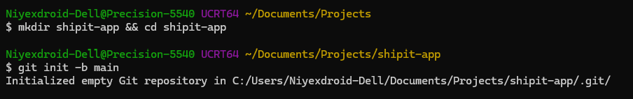

---

## 2. Write the smallest useful web app

I didn't want a framework getting in the way, so the app uses only Python's built-in `http.server`. No `pip install`, no `requirements.txt`.

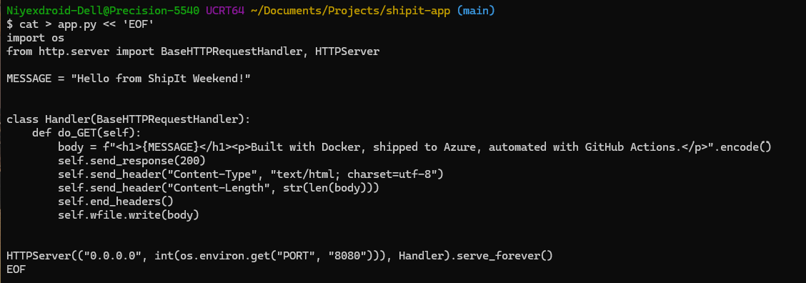

Two details matter here:

- **It listens on `0.0.0.0`**, not `localhost`. Inside a container, `localhost` means "only inside this container", so nothing outside could reach it.
- **The port comes from the `PORT` environment variable** (falling back to `8080`). Cloud platforms like to choose the port themselves, and this lets them.

---

## 3. Put it in a container

The Dockerfile is seven lines:

```dockerfile
FROM python:3.12-slim
WORKDIR /app
COPY app.py .
ENV PORT=8080
EXPOSE 8080
USER nobody
CMD ["python", "app.py"]
```

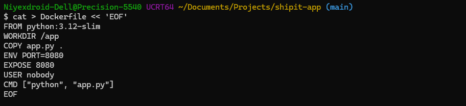

- `python:3.12-slim` keeps the image small.
- `USER nobody` means the app doesn't run as root. If someone ever broke into it, they'd have almost no permissions.

Building the image took about four seconds:

```bash
docker build -t shipit-app .
```

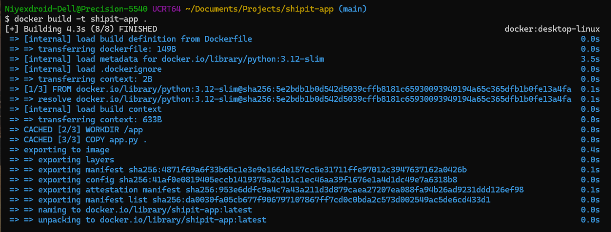

---

## 4. Test it locally

Before anything goes near the cloud, it has to work on my machine. I started the container in the background, then used a small loop that keeps trying `curl` until the server answers (a container can take a moment to start).

```bash
docker run -d --rm -p 8080:8080 --name shipit shipit-app
for i in $(seq 1 10); do curl -s http://localhost:8080 && break; sleep 1; done; echo
```

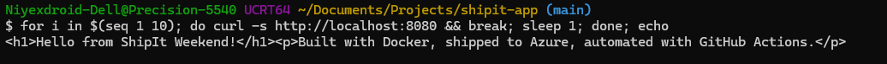

It works. Stop the container and save the first commit:

```bash
docker stop shipit
git add app.py Dockerfile
git commit -m "feat: containerised web app"
```

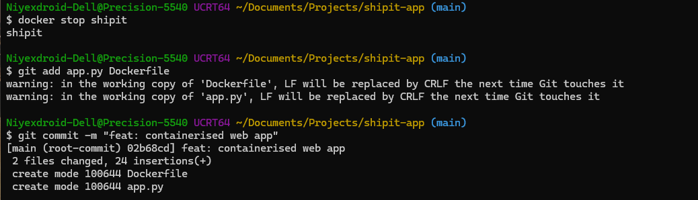

---

## 5. Push the code to GitHub

My first push failed with `Repository not found`, because I hadn't created the repo on GitHub yet. Once I created an empty `shipit-app` repo on github.com, the same push went straight through.

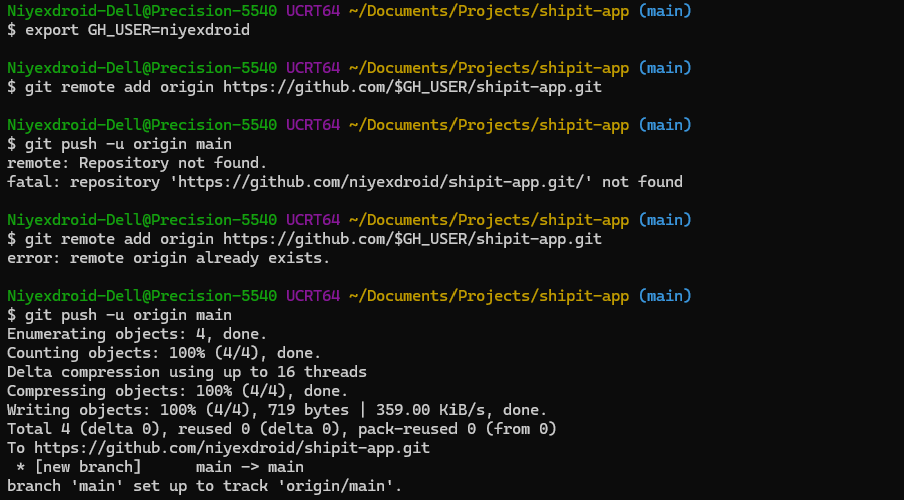

> **Lesson:** `git remote add` only saves a URL. It doesn't create anything on GitHub. The repo has to exist first.

---

## 6. Publish the image to GitHub Container Registry

Azure needs somewhere to download the image from. I used **GitHub Container Registry (GHCR)** so the code and the image live in the same place.

First, I added a label to the Dockerfile that links the image to the repository. That makes the package show up on the repo's GitHub page:

```bash
echo "LABEL org.opencontainers.image.source=https://github.com/$GH_USER/shipit-app" >> Dockerfile
git commit -am "chore: link image to repository" && git push
```

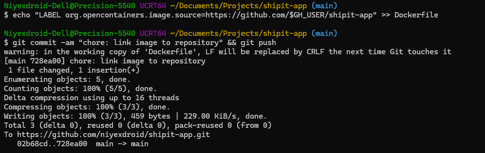

Then I built the image with its full registry name and pushed it:

```bash
docker build -t ghcr.io/$GH_USER/shipit-app:v1 .
docker push ghcr.io/$GH_USER/shipit-app:v1
```

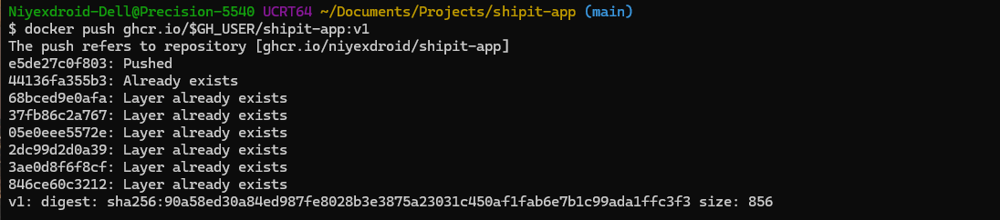

---

## 7. Deploy to Azure Container Apps

**Azure Container Apps** runs a container for you and gives it an HTTPS address, with no servers or Kubernetes to manage.

A bit of one-time setup: install the Container Apps CLI extension, switch on the Azure services it relies on, and create a resource group (a folder that holds everything for this project):

```bash
az extension add --name containerapp --upgrade
az provider register --namespace Microsoft.App --wait
az provider register --namespace Microsoft.OperationalInsights --wait
az group create --name shipit-rg --location northeurope
```

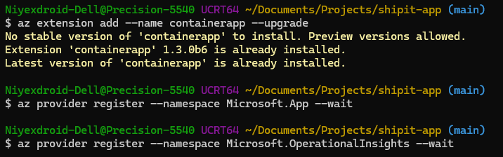

Then one command creates the app. I read my GHCR token into a variable with `read -s`, so it never appears on screen or in my shell history:

```bash
read -s -p "GHCR token: " GHCR_TOKEN; echo

az containerapp up --name shipit-app --resource-group shipit-rg --location northeurope \
  --image ghcr.io/$GH_USER/shipit-app:v1 --ingress external --target-port 8080 \
  --registry-server ghcr.io --registry-username $GH_USER \
  --registry-password "$GHCR_TOKEN"
```

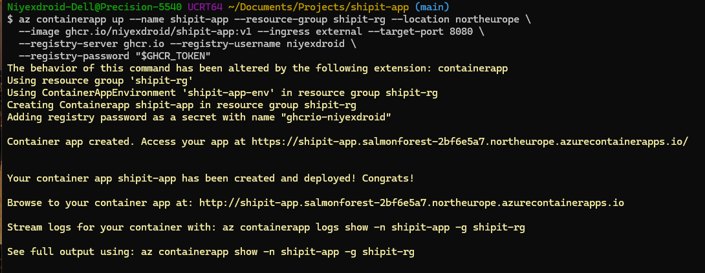

Azure created the hosting environment, stored the registry password as a secret, and handed back a public URL. A quick check:

```bash
export APP_URL=https://$(az containerapp show --name shipit-app --resource-group shipit-rg \
  --query properties.configuration.ingress.fqdn -o tsv)
curl $APP_URL
```

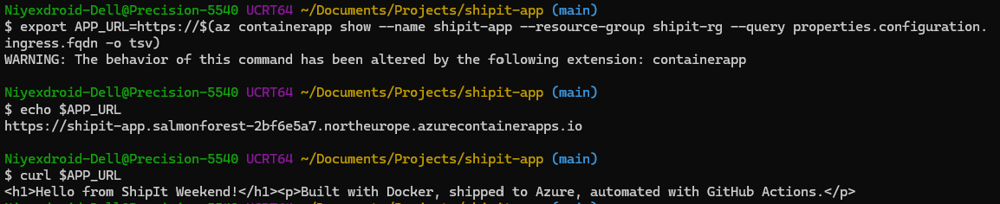

**It's live on the internet.** But every future change would still mean repeating steps 6 and 7 by hand. Next, I automated that.

---

## 8. Automate it with GitHub Actions

### Give GitHub permission to deploy

GitHub Actions needs its own Azure login. I created a **service principal** (a robot account) that can only change things inside `shipit-rg` and nothing else in my subscription:

```bash
export SUB_ID=$(az account show --query id -o tsv)
export SCOPE="/subscriptions/$SUB_ID/resourceGroups/shipit-rg"

MSYS_NO_PATHCONV=1 az ad sp create-for-rbac --name shipit-github \
  --role contributor --scopes "$SCOPE" --json-auth
```

The command prints a block of JSON credentials. I pasted that whole block into a GitHub repository secret called **`AZURE_CREDENTIALS`** (*Settings → Secrets and variables → Actions*).

> **Windows / Git Bash gotcha:** without `MSYS_NO_PATHCONV=1`, Git Bash sees the `/subscriptions/...` scope, thinks it's a file path, and rewrites it into a Windows path. Azure then rejects it.

> I'm not showing a screenshot of this step on purpose: the output contains a live password.

### The workflow

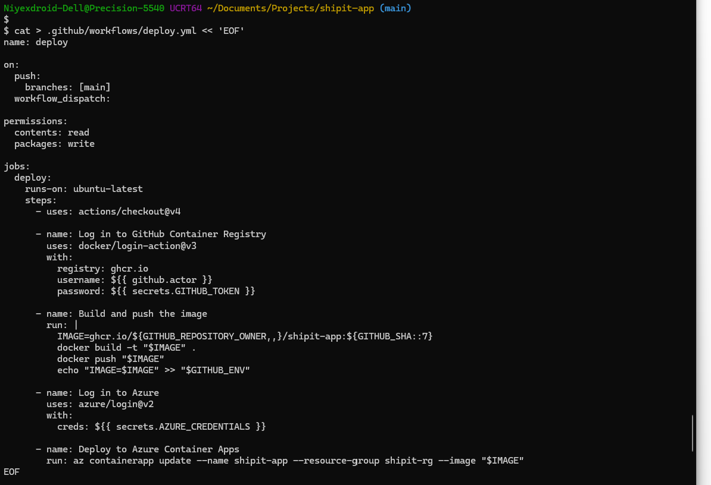

[`.github/workflows/deploy.yml`](.github/workflows/deploy.yml) runs on every push to `main` (or when started by hand from the Actions tab) and does four things:

| Step | What it does |
| --- | --- |
| **Log in to GHCR** | Uses the built-in `GITHUB_TOKEN`, so no extra secret is needed. |
| **Build and push** | Tags the image with the first 7 characters of the commit ID, so every deploy points to an exact commit. |
| **Log in to Azure** | Uses the `AZURE_CREDENTIALS` secret from above. |
| **Deploy** | `az containerapp update` tells Azure to switch to the new image. |

A small detail I liked: `${GITHUB_REPOSITORY_OWNER,,}` lowercases the GitHub username, because image names on GHCR must be lowercase.

### Proving it works

To test the pipeline, I changed the message in `app.py` and pushed. I didn't build anything or touch Azure myself:

```bash
sed -i.bak 's/Hello from ShipIt Weekend!/Shipped automatically by GitHub Actions!/' app.py && rm app.py.bak
git add .github/workflows/deploy.yml app.py
git commit -m "ci: deploy to Azure on every push"
git push
```

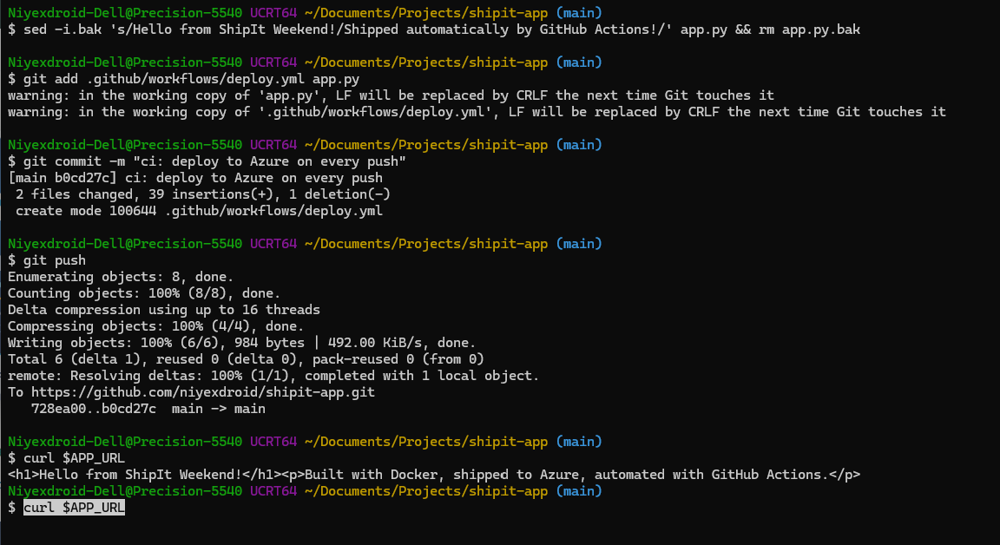

Look at the `curl` right after the push: it still shows the **old** message. That's expected. The workflow needs a minute or two to build the image and roll it out. Once the run turned green in the Actions tab, the same URL served the new text:

```html
<h1>Shipped automatically by GitHub Actions!</h1>
```

From now on, **`git push` is the deploy button.**

---

## 9. What I learned

- **Start small.** An app with no dependencies let me focus on the pipeline instead of fixing app bugs.
- **Make it work locally first.** If it works in Docker on my laptop, it'll almost certainly work in the cloud, because it's the same image.
- **Give automation the least access it needs.** The deploy robot can only touch one resource group.
- **Keep secrets out of sight.** `read -s` for tokens, GitHub Secrets for credentials, and nothing sensitive in screenshots or commits.
- **Tag images with the commit ID.** It's always clear exactly which code is running, and rolling back means pointing at an older tag.
- **Mistakes are part of the process.** The failed first push and the Git Bash path issue were the parts that taught me the most.

---

## Run it yourself

**You'll need:** Docker, Git, the Azure CLI (`az login` done), a GitHub account, and a GitHub personal access token with the `write:packages` scope.

```bash
# Run locally
docker build -t shipit-app .
docker run --rm -p 8080:8080 shipit-app
# open http://localhost:8080
```

To deploy your own copy, fork this repo, follow steps 6 to 8 with your own GitHub username, add the `AZURE_CREDENTIALS` secret, and push.

### Clean up

Everything lives in one resource group, so one command removes it all (and stops any charges):

```bash
az group delete --name shipit-rg --yes --no-wait
```

---

## Project structure

```
shipit-app/
├── app.py                        # The web app (Python standard library only)
├── Dockerfile                    # Container image definition
├── .github/workflows/deploy.yml  # CI/CD: build → push to GHCR → deploy to Azure
└── docs/images/                  # Screenshots used in this README
```
